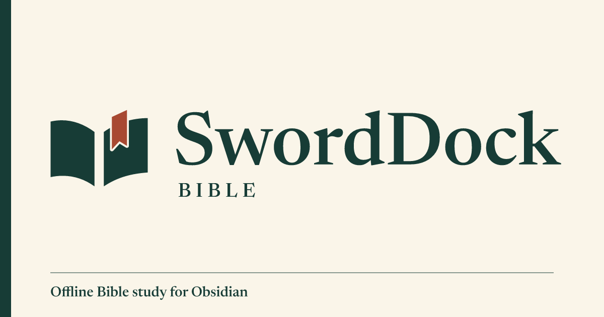
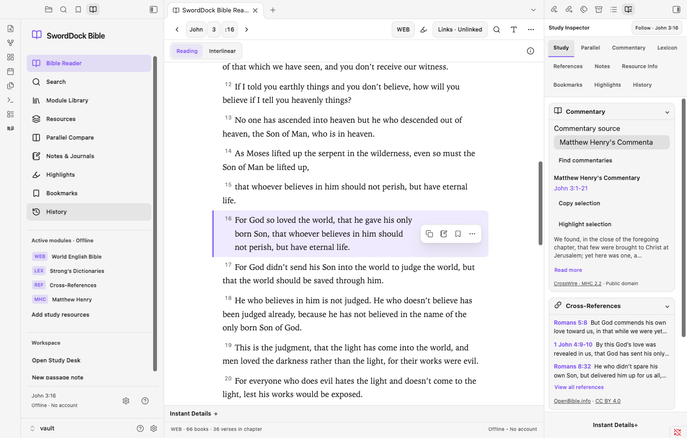
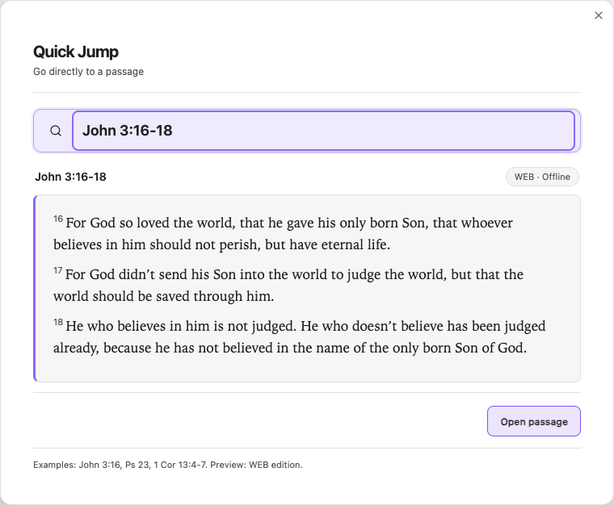
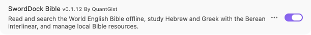
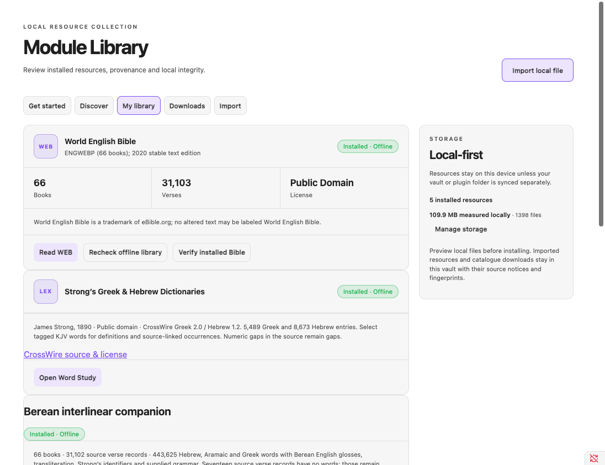

# SwordDock Bible



Read the World English Bible offline in Obsidian. Study a verse with its Berean Hebrew, Aramaic or Greek companion, then insert the passage and your notes into ordinary Markdown.



[Follow the illustrated guide to reading, word study, search and Markdown notes](docs/reading-guide.md).

## Start reading

Open the command palette and run **SwordDock Bible: Open Bible Reader**. Use Quick Jump to open a passage such as **John 3:16**. Select **Interlinear** to see the original words, transliterations, Berean English glosses and Strong’s entries. Word order and numbering follow the source. The companion explicitly identifies the 17 verses for which the source supplies no words.



**Open Bible Study Desk** opens the Reader and Inspector together. Search by phrase or individual words, compare available editions, bookmark and highlight verse ranges, and follow commentary references. The library includes the 66-book WEB, Berean interlinear, Strong’s dictionaries, OpenBible cross-references and Matthew Henry’s Commentary.

## Installation and upgrades

SwordDock uses the three files that Obsidian installs from a release. The Community build includes the compressed library and SQLite engine inside `main.js`. Opening a book expands only the requested data. Reading works offline from the first launch.

For manual installation, download **main.js**, **manifest.json** and **styles.css** from the same release. Place them directly inside `<vault>/.obsidian/plugins/versedock/`, reopen Obsidian and enable **SwordDock Bible** in Community plugins. The complete manual ZIP is an alternative. On upgrade, keep the existing plugin folder, `data.json`, study notes and installed resources. The historical plugin ID is `versedock`. [GitHub releases](https://github.com/dernestbank/versedock-obsidian/releases)



## Editions and source rights

The worldwide stable distribution omits the full King James Version. WEB is the default Scripture text. Existing, separately installed tagged KJV files from a previous installation remain usable, including tagged word study and the labelled Berean companion. Source-specific verse numbering is preserved. UK rights in the Authorized Version are vested in the Crown. Obtain any permission needed for local use or redistribution. [CrossWire’s source notice](https://crosswire.org/sword/modules/ModInfo.jsp?modName=KJV) · [Cambridge permissions](https://www.cambridge.org/sites/default/files/media/documents/Bibles%20Request%20Form%20-%20Permissions.pdf)

## Mark verses and phrases

Select a verse, Shift-click to extend a verse range, or select the exact words you want to mark. Choose the **highlighter** in the Reader toolbar. Pick a color and choose **Highlight** or **Underline**. You can attach a note before saving. In a commentary, dictionary, or book, select the words and choose **Copy selection** or **Highlight selection**. [Illustrated annotation guide](docs/annotations.md)

## Additional resources

In **Module Library**, choose a publisher resource or **Import local file**. Compatible SQLite and gzip inputs include Bibles, commentaries, dictionaries, books, devotionals and graphics. Review the source, samples and size before installation. The original file is preserved. Rich entries retain supported formatting, source links and original content. Library management includes updates, version selection, repair and reversible removal.



Publisher downloads contact the MySword publisher at `mysword-bible.info` when you select an install or repair. SwordDock checks the pinned file hashes before activation. Desktop supports transfer cancellation and validated resume. On mobile, cancelling prevents activation while the host may finish its current network request. Compressed publisher modules and gzip local imports on iPadOS require 16.4 or newer.

Reading, search, and SQLite import run on your device. The plugin keeps settings and installed resources in your vault. It has no telemetry, accounts or cloud service. Obsidian and the user’s configured sync or backup tools may copy vault files independently.

## Local development

Requirements: Node.js 22+, Python 3, and desktop Obsidian.

```bash
git clone https://github.com/dernestbank/versedock-obsidian.git
cd versedock-obsidian
npm ci
npm run check
npm run deploy:test
npm run package:community
npm run package:preview
npm run smoke:preview
```

Open `test-vault` as a separate vault in Obsidian and enable the development plugin. The committed `library/webp` contains validated public-domain data, so an additional data download is not necessary just to build. To regenerate the source precisely, download `https://ebible.org/Scriptures/engwebp_vpl.zip` to `.research/engwebp_vpl.zip` and run `npm run library:build`.

The published 0.1.11 tag retains the historical KJV compatibility fixtures. The current checkout and release archives omit those files. CI retrieves the pinned historical fixture for migration tests. Local tests run the corpus-specific cases when that fixture is present.

## Credits and support

SwordDock Bible is an independent QuantGist project. Obsidian, MySword and CrossWire are independent projects. Each bundled resource retains its own attribution and licence. This source-code license does not override separate rights/provenance for included Bible content; see library/webp/SOURCE-LICENSE.md. [WEB](library/webp/SOURCE-LICENSE.md) · [Berean](library/interlinear/SOURCE-LICENSE.md) · [Strong’s](library/strongs/SOURCE-LICENSE.md) · [Cross-references](library/crossrefs/SOURCE-LICENSE.md) · [Commentary](library/mhc/SOURCE-LICENSE.md)

[Code licence](LICENSE) · [Artwork and usage](assets/brand/README.md) · [Changelog](CHANGELOG.md) · [Report an issue](https://github.com/dernestbank/versedock-obsidian/issues)
