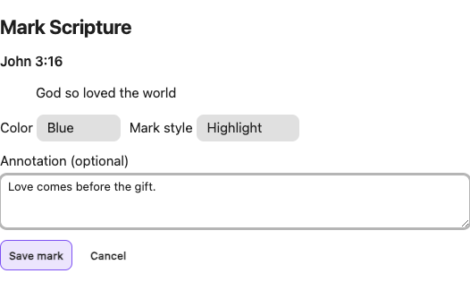
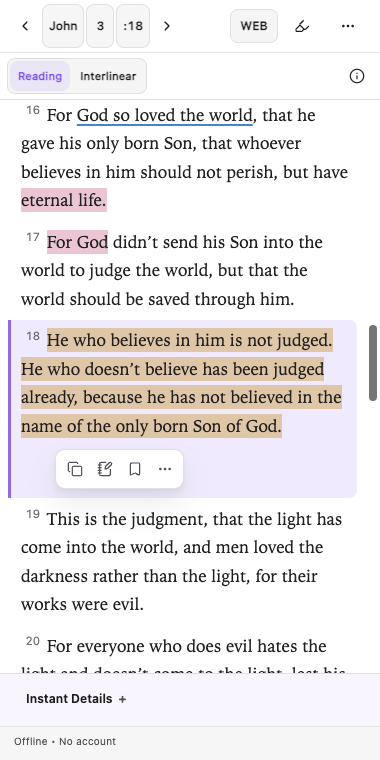

# Mark verses and phrases

In the Bible Reader, select the words you want to remember. A selection can start in one verse and end in the next within the same chapter. To mark a whole verse, click its verse number. To mark several whole verses, click the first verse number and Shift-click the last.

Choose the highlighter in the Reader toolbar (**Mark selected text or verses**). The dialog shows the reference and the exact words you selected. Choose a color and **Highlight** or **Underline**. Add a note if you like, then choose **Save mark**.

The example below shows a blue underline beneath a phrase in John 3:16, a rose highlight across the end of verse 16 and the start of verse 17, and an amber highlight on all of verse 18.

Click marked text in Reading mode to edit its color, style or note. Choose **Remove mark** to delete it. The **Highlights** section of the navigation dock lists your annotations, including overlapping marks. Each entry shows the passage, edition, quotation and note. Use **Open passage** to return to the text or **Edit annotation** to change the mark.

SwordDock stores annotations in this vault’s plugin settings. Each is attached to the edition and the selected occurrence of the quoted words. If a replacement module changes the text at that position, you can still read the original quotation and note in **Highlights**. The Reader also retains whole-passage highlights created with its **More actions** menu.
