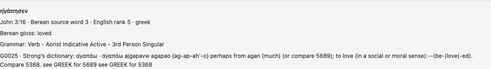
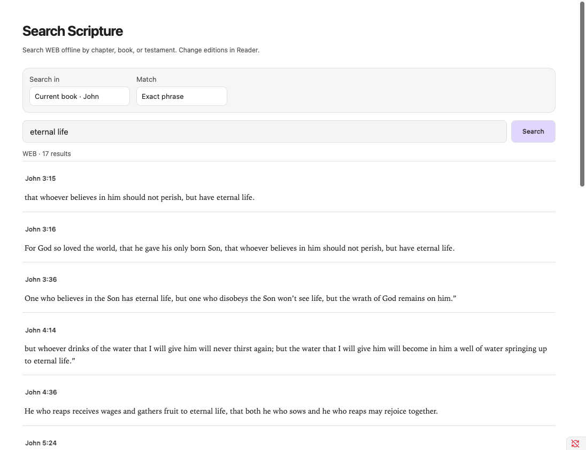
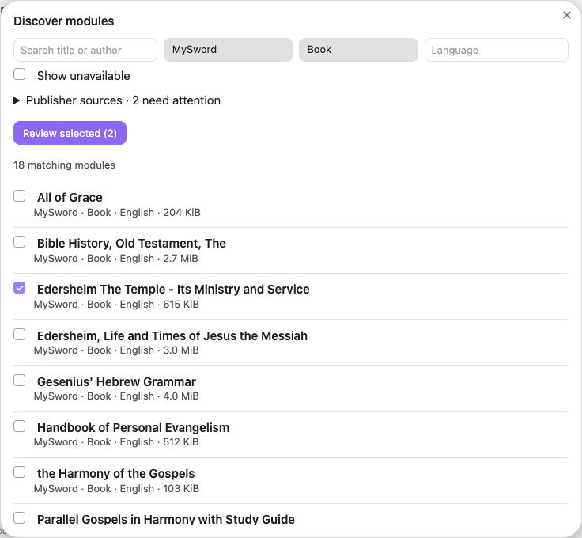
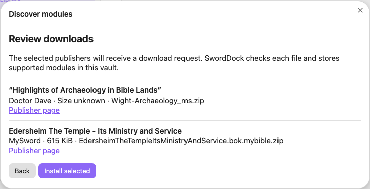

# Reading and studying with SwordDock Bible

This walkthrough uses John 3 in the World English Bible (WEB) that comes with SwordDock. The screenshots show desktop Obsidian on macOS. Run the named commands from Obsidian’s command palette.

[Installation and upgrades](../README.md#installation-and-upgrades) · [Find a passage](#find-a-passage) · [Study a word](#study-a-word) · [Search the text](#search-the-text) · [Insert a passage into a note](#insert-a-passage-into-a-note) · [Find your offline resources](#find-your-offline-resources)

## Find a passage

Run **Open Bible Reader**, then **Quick Jump to Scripture reference**. Enter `John 3:16-18`. Check the range and edition in the preview, then choose **Open passage**.

Click verse 16 to select it. The action bar beside the verse lets you copy it, open a study note, or bookmark it. To select a range, click the first verse and Shift-click the last one.

Run **Open Bible Study Desk** to read alongside Matthew Henry’s Commentary and cross-references. The Inspector on the right follows the selected passage. Click **Follow** to pin the Inspector to that verse while you read elsewhere. Click **Pinned** to resume following.

## Study a word

With John 3:16 selected, choose **Interlinear** above the passage. Each card shows one source word. Use **Word order** to switch between **Original** and **Berean English**. Open **Display** to choose whether the cards show transliterations, glosses, Strong’s numbers or grammar.

Select **ἠγάπησεν** (“loved”). Its detail panel identifies the verb form and opens the bundled Strong’s entry. The English gloss on a card comes from the Berean companion. The verse in the Reader uses the selected Bible edition.

For colored highlights, underlines and notes on selected words, see the [annotation guide](annotations.md).

## Search the text

If you remember the words but not the reference, run **Search installed Bible**. To find the phrase *eternal life* in John, open John in the Reader first. In Search, choose **Current book · John** and **Exact phrase**, type `eternal life`, and choose **Search**. Select a result’s verse reference to open it in the Reader.

## Insert a passage into a note

Open a Markdown note and place the cursor where you want the verse. Run **Quick Verse Insert into Markdown** and enter `John 3:16`. Choose **Insert callout** for the result shown below. **Insert quote** and **Insert reference link** are available in the same preview.

Switch the note to Reading view to see the inserted callout.

## Find your offline resources

Run **Open Module Library** and select **My library**. On a fresh install you’ll find WEB, Strong’s dictionaries, the Berean companion, cross-references and Matthew Henry’s Commentary. **Read WEB** opens the Reader. **Import local file** lets you preview a compatible module before installing it.

## Install publisher modules

Open **Module Library → Discover → Discover modules**. Search by title or author. Use the publisher, resource type and language filters to narrow the list. Selections stay checked as you move between publishers.

Choose **Review selected** to see the publisher, filename and estimated size for each download. Some publishers omit file sizes. Choose **Install selected**. For a ZIP containing several compatible modules, select the individual files you want. Keep the wizard open while it works. Each download has its own status and Cancel or Retry control.

**Open** takes you to the installed title. After a restart, find it under **Module Library → My library**. Installed resources, source notices and fingerprints stay in the current vault. Moving to another device requires transferring the vault’s SwordDock resource files or installing the same modules there.

Open **Publisher sources** to refresh a collection listing or load another page where available. A failed refresh leaves the last successful catalogue available for browsing. Turn on **Show unavailable** to see entries that require a publisher account or lack a supported public download. Installation accepts unencrypted MySword SQLite databases and compatible gzip or ZIP files up to 64 MiB, including the expanded content.
