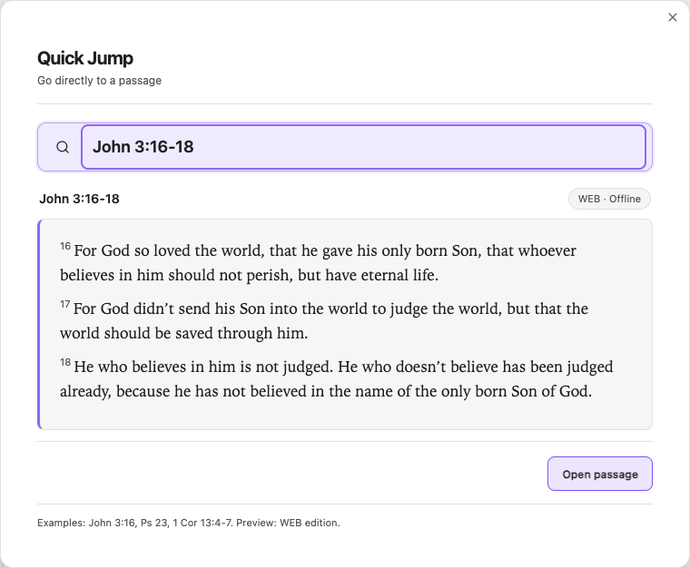
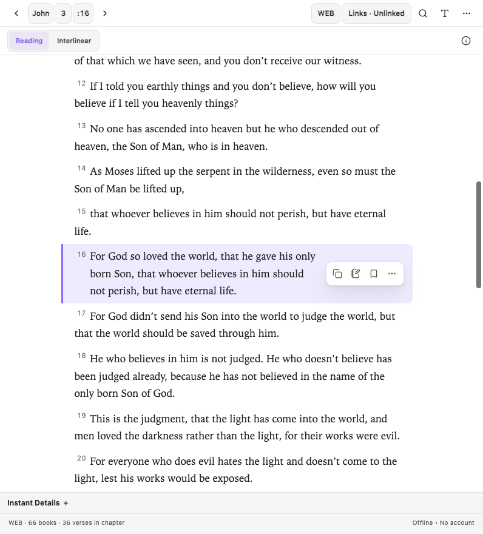
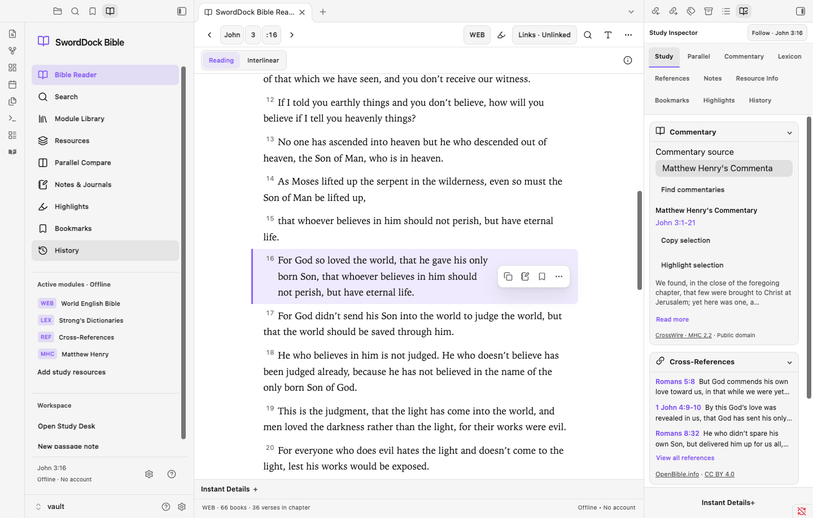
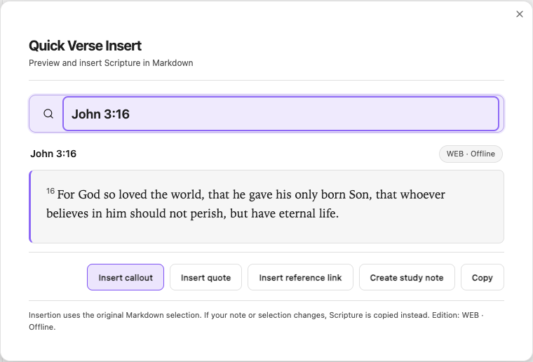
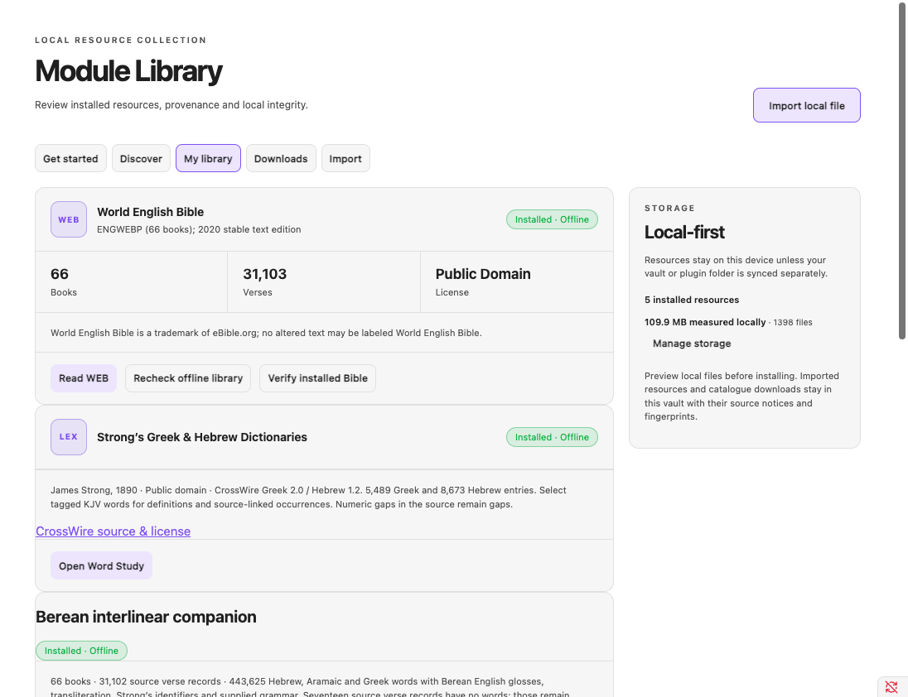

# Reading and studying with SwordDock Bible

This walkthrough uses John 3 in the World English Bible (WEB) that comes with SwordDock. The screenshots show SwordDock Bible 0.1.12 in desktop Obsidian 1.15.1 on macOS. Run the named commands from Obsidian’s command palette.

[Installation and upgrades](../README.md#installation-and-upgrades) · [Find a passage](#find-a-passage) · [Study a word](#study-a-word) · [Search the text](#search-the-text) · [Insert a passage into a note](#insert-a-passage-into-a-note) · [Find your offline resources](#find-your-offline-resources)

## Find a passage

Run **Open Bible Reader**, then **Quick Jump to Scripture reference**. Enter `John 3:16-18`. Check the range and edition in the preview, then choose **Open passage**.

Click verse 16 to select it. The action bar beside the verse lets you copy it, open a study note, or bookmark it. To select a range, click the first verse and Shift-click the last one.

Run **Open Bible Study Desk** to read alongside Matthew Henry’s Commentary and cross-references. The Inspector on the right follows the selected passage. Click **Follow** to pin the Inspector to that verse while you read elsewhere. Click **Pinned** to resume following.

## Study a word

With John 3:16 selected, choose **Interlinear** above the passage. Each card shows one source word. Use **Word order** to switch between **Original** and **Berean English**. Open **Display** to choose whether the cards show transliterations, glosses, Strong’s numbers or grammar.

Select **ἠγάπησεν** (“loved”). Its detail panel identifies the verb form and opens the bundled Strong’s entry. The English gloss on a card comes from the Berean companion. The verse in the Reader uses the selected Bible edition.

For colored highlights, underlines and notes on selected words, see the [annotation guide](annotations.md).

## Search the text

If you remember the words but not the reference, run **Search installed Bible**. To find the phrase *eternal life* in John, open John in the Reader first. In Search, choose **Current book · John** and **Exact phrase**, type `eternal life`, and choose **Search**. Select a result’s verse reference to open it in the Reader.

## Preview a reference in a note

Type a reference in ordinary prose, such as `John 3:16`, `Jn 3:16–18` or `1 Corinthians 13:4–7`. Hover over it in Reading View or Live Preview to read the passage in the current offline Bible. Choose **Open in SwordDock** to take that same passage to the Reader.

In Reading View, Tab to a reference and press Enter. In the editor, put the cursor inside the reference and run **Preview Scripture at cursor**. Automatic recognition looks for a book followed by a chapter and verse, with an optional range in the same chapter. Code and existing links keep their normal behavior.

Under **Settings → SwordDock Bible → Notes & references**, toggle **Reading View verse previews** or **Live Preview verse previews** independently. The editor command remains available with automatic previews off. If an edition lacks a passage, the preview displays the lookup error.

## Insert a passage into a note

Open a Markdown note and place the cursor where you want the verse. Run **Quick Verse Insert into Markdown** and enter `John 3:16`. Choose an installed **Bible translation**. The Reader and subsequent previews use that choice too. Choose **Insert callout** for the result shown below, **Insert quote** for a Markdown blockquote, or **Insert reference** for an inline reference with its translation. **Insert reference link** links to the configured Scripture study-note path. The editor replaces the selected text or inserts at the cursor in one undo step.

Switch the note to Reading view to see the inserted callout.

## Cite a resource in a note

Place the cursor in an open Markdown note and run **Insert resource citation from dock**. In the Resources dock, find the commentary section, passage, dictionary headword, book entry, devotional reading or map you want. Choose **Cite entry**, check the resource and location, then choose **Insert into** followed by your note’s name. **Copy Markdown citation** also works while reading without an editor open.

The note stores an ordinary Markdown link with a label such as **Matthew Henry’s Commentary · MHC 2.2 · John 3:1-21**. Follow the link in Reading View to reopen that section. The address includes the vault name. Imported entries also identify their source version so that an updated module cannot silently open a different entry. After removing a module, you can still read the label in any Markdown editor. Restore the cited source in Module Library to follow the link again.

## Find your offline resources

Run **Open Module Library** and select **My library**. On a fresh install you’ll find WEB, Strong’s dictionaries, the Berean companion, cross-references and Matthew Henry’s Commentary. **Read WEB** opens the Reader. **Import local file** lets you preview a compatible module before installing it.

